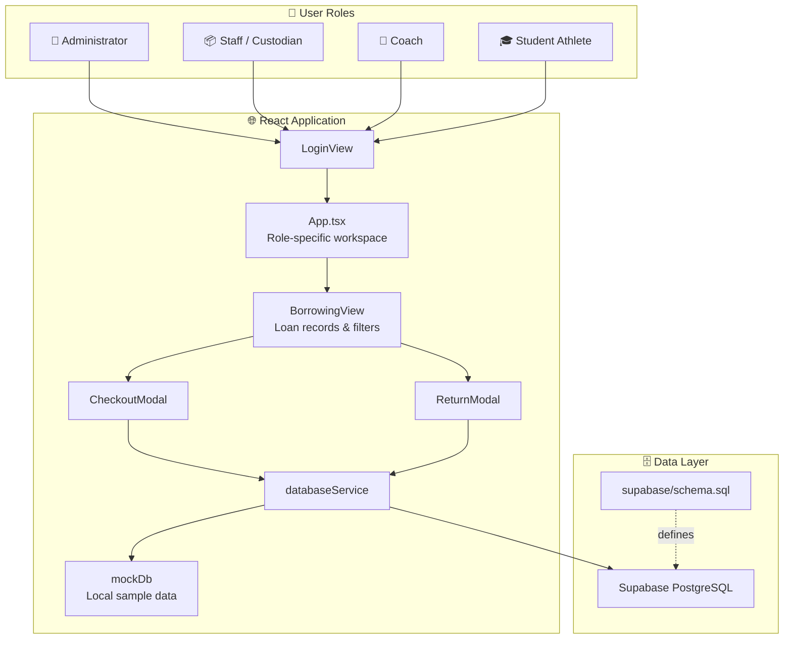

<div align="center">

  

  # 🦅 FalconSystem
  ### **Athletic Equipment & Resource Management System**
  *Advanced Database Systems & Enterprise Resource Allocation Portal*

  <p align="center">
    
    
    
    
  </p>

  <p align="center">
    <a href="#-interactive-workspaces">Workspaces</a> •
    <a href="#-system-architecture--how-it-works">How It Works</a> •
    <a href="#-borrowing-records">Borrowing Records</a> •
    <a href="#-quick-start-guide">Quick Start</a> •
    <a href="#-project-structure">Project Structure</a>
  </p>

</div>

---

> [!NOTE]
> **Academic Project Notice**: FalconSystem is an athletic equipment and resource management application built with React, TypeScript, Vite, and Supabase. The repository includes a PostgreSQL schema with database views, functions, and triggers.

---

## 📌 Executive Summary

<table>
<tr>
<td width="60%">

**FalconSystem** is a web application for managing athletic equipment, borrowing transactions, athletes, and teams for **Falcons Athletics**.

Staff can manage inventory and equipment checkouts and returns. Coaches and student athletes have role-specific workspaces for team resources and equipment-related activities. The application can use Supabase for database access and includes mock data for local exploration.

</td>
<td>

### 🚀 Highlights at a Glance
- 👥 **Role-Specific Workspaces** (Administrator, Staff, Coach, Student)
- 📦 **Equipment Inventory** and condition tracking
- 🔄 **Borrowing Records** with active, overdue, partial-return, and returned statuses
- 🧾 **Expandable Loan Details** with per-item quantities and conditions
- ☁️ **Supabase PostgreSQL** integration and local mock-data mode

</td>
</tr>
</table>

---

## 🔄 System Architecture & How It Works



---

## 👥 Interactive Workspaces

FalconSystem presents a workspace based on the selected user role:

<details open>
<summary><b>👑 Administrator Workspace</b></summary>
<br>

The administrator dashboard provides a high-level view of the system. Administrator navigation also includes management views such as athletes, teams, equipment, borrowing, maintenance, and audit logs.

</details>

<details open>
<summary><b>📦 Staff & Custodian Workspace</b></summary>
<br>

Staff can work with equipment inventory and condition, manage loan checkouts and returns, review bookings, and submit reports.

</details>

<details>
<summary><b>🏅 Coach Workspace</b></summary>
<br>

The coach dashboard provides access to team-related information and equipment borrowing workflows.

</details>

<details>
<summary><b>🎓 Student Athlete Workspace</b></summary>
<br>

The student workspace provides access to equipment and coach-related activities, including booking and loan information.

</details>

---

## 🔄 Borrowing Records

The borrowing records interface is implemented in [`src/pages/BorrowingView.tsx`](src/pages/BorrowingView.tsx). It displays transaction summaries and detailed loan records:

| View Feature | Description |
| :--- | :--- |
| **Summary cards** | Counts total transactions, active loans, overdue loans, and completed returns. |
| **Status filters** | Filters records by all, active, overdue, or returned. |
| **Transaction details** | Shows borrower, expected return date, approving staff member, remarks, and item return totals. |
| **Expandable item rows** | Shows equipment name and code, borrowed and returned quantities, conditions, and item return status. |
| **New Checkout** | Opens the checkout workflow for non-student roles. |
| **Process Return** | Opens the return workflow for transactions that have not been fully returned. |

Checkout and return dialogs are implemented in [`src/components/CheckoutModal.tsx`](src/components/CheckoutModal.tsx) and [`src/components/ReturnModal.tsx`](src/components/ReturnModal.tsx). The shared transaction and item models, including partial return statuses, are defined in [`src/types/database.ts`](src/types/database.ts).

---

## ⚡ Database & Data Features

<div align="center">

| Feature Type | Object / File | Description |
| :--- | :--- | :--- |
| **Database schema** | `supabase/schema.sql` | Defines the PostgreSQL tables and relationships used by the application. |
| **Database views** | `vw_active_loans_summary` | Provides a summary of active loans, borrowers, overdue days, and returned units. |
| **Database views** | `vw_equipment_inventory_status` | Summarizes equipment quantities, utilization, stock health, and maintenance jobs. |
| **Supabase client** | `src/services/supabase.ts` | Connects to Supabase and exposes application data operations. |
| **Mock data** | `src/services/mockData.ts` | Supplies local sample data and operations when exploring without a live database. |

</div>

---

## 📁 Project Structure

```text
📂 IM101_js/
├── 📂 public/
│   └── 📂 images/                 # Application branding and static images
├── 📂 src/
│   ├── 📂 components/             # Navigation, modals, and shared UI components
│   │   ├── 📄 CheckoutModal.tsx   # Equipment checkout workflow
│   │   └── 📄 ReturnModal.tsx     # Equipment return workflow
│   ├── 📂 pages/                  # Role dashboards and application views
│   │   └── 📄 BorrowingView.tsx   # Borrowing records, filters, and item details
│   ├── 📂 services/               # Supabase integration and mock data
│   ├── 📂 types/                  # Shared TypeScript data models
│   ├── 📄 App.tsx                 # Application shell and role-based workspace
│   └── 📄 index.css               # Global application styles
├── 📂 supabase/
│   └── 📄 schema.sql              # PostgreSQL schema and database objects
├── 📄 .env.example                # Supabase environment variable template
├── 📄 package.json                # Dependencies and npm scripts
└── 📄 vite.config.ts              # Vite configuration
```

---

## 🚀 Quick Start Guide

### 1. Requirements
* **Node.js** and **npm**
* A **Supabase project** for live database mode (optional when using mock data)

### 2. Installation Steps

```bash
# 1. Install dependencies
npm ci

# 2. Optional: configure Supabase
# Copy .env.example to .env and fill in the project URL and public anon key.

# 3. Start the development server
npm run dev
```

Open the local URL printed by Vite in your browser. When Supabase is not configured, the app can use its mock-data mode.

To enable Supabase, set these values in `.env`:

```dotenv
VITE_SUPABASE_URL=https://your-project-id.supabase.co
VITE_SUPABASE_ANON_KEY=your-supabase-anon-key
```

> [!WARNING]
> `supabase/schema.sql` drops and recreates application tables and views. Review it and run it only against a new or disposable database unless you intend to replace its existing data. Never expose a Supabase `service_role` key in frontend code or environment variables.

### 3. Available Commands

| Command | Description |
| :--- | :--- |
| `npm run dev` | Starts the Vite development server. |
| `npm run build` | Runs TypeScript checks and creates the production build in `dist/`. |
| `npm run preview` | Previews the production build locally. |

---

## 👨‍💻 Development Team

<div align="center">

| Member | Assigned Specialty | Core Contributions |
| :---: | :---: | :--- |
| **Sam Udtohan** | **Backend & Database** | Database design, Supabase integration, and application data workflows. |
| **Rizamae Velasco** | **Database Management** | Database schema design and database automation. |
| **Ace Arcamo** | **Frontend** | UI/UX engineering, React components, dashboards, and responsive layouts. |

</div>

<br>

<div align="center">
  <sub>FalconSystem • Advanced Database Systems (IM101a) • Academic Project</sub>
</div>
