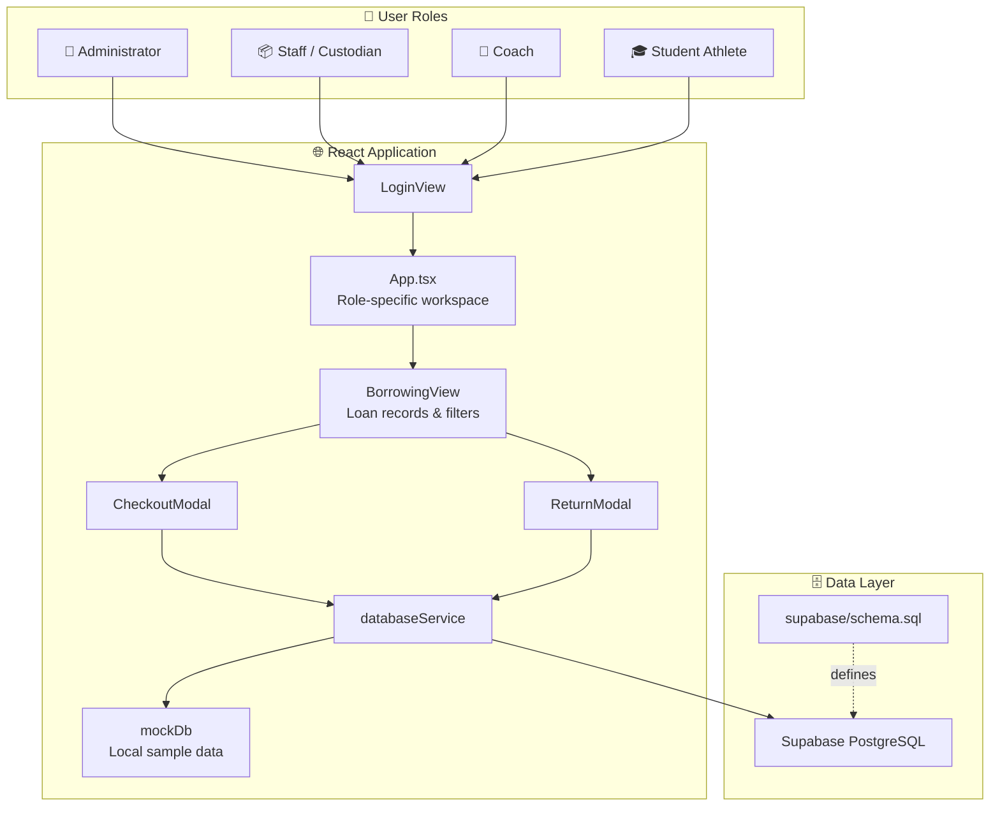

<div align="center">

  

  # 🦅 FalconSystem
  ### **Athletic Equipment & Resource Management System**
  *Advanced Database Systems & Enterprise Resource Allocation Portal*

  <p align="center">
    
    
    
    
    
  </p>

  <p align="center">
    <a href="#-interactive-workspaces">Workspaces</a> •
    <a href="#-system-architecture--how-it-works">How It Works</a> •
    <a href="#-borrowing-records">Borrowing Records</a> •
    <a href="#-quick-start-guide">Quick Start</a> •
    <a href="#-project-structure">Project Structure</a>
  </p>

</div>

---

> [!NOTE]
> **Academic Project Notice**: FalconSystem is an athletic equipment and resource management application built with React, TypeScript, Vite, and Supabase. The repository includes a PostgreSQL schema with database views, functions, and triggers.

---

## 📌 Executive Summary

<table>
<tr>
<td width="60%">

**FalconSystem** is a web application for managing athletic equipment, borrowing transactions, athletes, and teams for **Falcons Athletics**.

Staff can manage inventory and equipment checkouts and returns. Coaches and student athletes have role-specific workspaces for team resources and equipment-related activities. The live database is hosted on Supabase Cloud PostgreSQL with Supabase Auth enforcing role-based access control.

</td>
<td>

### 🚀 Highlights at a Glance
- 👥 **4-Role RBAC** (Admin, Staff, Coach, Student) with RLS
- 📦 **Equipment Inventory** and condition tracking
- 🔄 **Borrowing Records** with ACID-safe checkout RPC
- 🔒 **Supabase Auth** integration with JWT-based RLS
- ⚙️ **Edge Function Backend API** (Deno/TypeScript)
- 🧾 **4 PL/pgSQL Triggers** + 2 ACID RPCs + 2 Views
- ☁️ **GitHub Pages** deployment via CI/CD

</td>
</tr>
</table>

---

## 🔄 System Architecture & How It Works



---

## 👥 Interactive Workspaces

FalconSystem presents a workspace based on the selected user role:

<details open>
<summary><b>👑 Administrator Workspace</b></summary>
<br>

The administrator dashboard provides a high-level view of the system. Administrator navigation also includes management views such as athletes, teams, equipment, borrowing, maintenance, and audit logs.

</details>

<details open>
<summary><b>📦 Staff & Custodian Workspace</b></summary>
<br>

Staff can work with equipment inventory and condition, manage loan checkouts and returns, review bookings, and submit reports.

</details>

<details>
<summary><b>🏅 Coach Workspace</b></summary>
<br>

The coach dashboard provides access to team-related information and equipment borrowing workflows.

</details>

<details>
<summary><b>🎓 Student Athlete Workspace</b></summary>
<br>

The student workspace provides access to equipment and coach-related activities, including booking and loan information.

</details>

---

## 🔄 Borrowing Records

The borrowing records interface is implemented in [`src/pages/BorrowingView.tsx`](src/pages/BorrowingView.tsx). It displays transaction summaries and detailed loan records:

| View Feature | Description |
| :--- | :--- |
| **Summary cards** | Counts total transactions, active loans, overdue loans, and completed returns. |
| **Status filters** | Filters records by all, active, overdue, or returned. |
| **Transaction details** | Shows borrower, expected return date, approving staff member, remarks, and item return totals. |
| **Expandable item rows** | Shows equipment name and code, borrowed and returned quantities, conditions, and item return status. |
| **New Checkout** | Opens the checkout workflow for non-student roles. |
| **Process Return** | Opens the return workflow for transactions that have not been fully returned. |

Checkout and return dialogs are implemented in [`src/components/CheckoutModal.tsx`](src/components/CheckoutModal.tsx) and [`src/components/ReturnModal.tsx`](src/components/ReturnModal.tsx). The shared transaction and item models, including partial return statuses, are defined in [`src/types/database.ts`](src/types/database.ts).

---

## ⚡ Database & Data Features

<div align="center">

| Feature Type | Object / File | Description |
| :--- | :--- | :--- |
| **Schema** | `supabase/schema.sql` | 12 tables (3NF), 4 roles, 4 triggers, 2 RPCs, 2 views, 24 indexes, full RLS |
| **Backend API** | `supabase/functions/api/index.ts` | Deno Edge Function — JWT auth, RBAC, 7 REST routes |
| **Database tests** | `supabase/database_tests.sql` | 16 PASS/FAIL tests: constraints, triggers, RPCs, normalization |
| **Performance evidence** | `supabase/performance_report.sql` | 14 EXPLAIN ANALYZE queries + index usage statistics |
| **View: loans** | `vw_active_loans_summary` | Loan summary with overdue days and loan urgency labels |
| **View: inventory** | `vw_equipment_inventory_status` | Equipment utilization rates and stock health labels |
| **Supabase client** | `src/services/supabase.ts` | Auth + data service — throws on live errors, no silent fallback |
| **Mock data** | `src/services/mockData.ts` | Offline demo mode only — active when `.env` is not configured |

</div>

---

## 📁 Project Structure

```text
📂 IM101_js/
├── 📂 .github/workflows/
│   └── 📄 deploy.yml           # CI/CD → GitHub Pages
├── 📂 public/
│   └── 📂 images/              # Application branding
├── 📂 src/
│   ├── 📂 components/          # Navigation, modals, shared UI
│   │   ├── 📄 CheckoutModal.tsx
│   │   └── 📄 ReturnModal.tsx
│   ├── 📂 pages/               # Role dashboards and views
│   │   └── 📄 BorrowingView.tsx
│   ├── 📂 services/
│   │   ├── 📄 supabase.ts      # Auth + database service (live)
│   │   └── 📄 mockData.ts      # Offline demo data
│   ├── 📂 types/
│   │   └── 📄 database.ts      # TypeScript data models
│   └── 📄 App.tsx
├── 📂 supabase/
│   ├── 📄 schema.sql           # Full schema, RLS, triggers, RPCs, seed
│   ├── 📄 database_tests.sql   # 16 PASS/FAIL constraint & trigger tests
│   ├── 📄 performance_report.sql  # EXPLAIN ANALYZE + index stats
│   └── 📂 functions/
│       └── 📂 api/
│           └── 📄 index.ts     # Edge Function backend API (Deno)
├── 📄 CONTRIBUTING.md          # Branch protection & PR workflow
├── 📄 DATABASE_DEFENSE_GUIDE.md
├── 📄 .env.example
└── 📄 package.json
```

---

## 🚀 Quick Start Guide

### 1. Requirements
* **Node.js** and **npm**
* A **Supabase project** with the schema applied (`supabase/schema.sql`)
* **Supabase Auth users** created and linked to `users.user_auth_id` rows

### 2. Installation Steps

```bash
# 1. Install dependencies
npm ci

# 2. Configure Supabase (required for live mode)
# Copy .env.example to .env and fill in your project URL and anon key.

# 3. Apply the database schema
# Open the Supabase SQL Editor and run supabase/schema.sql

# 4. Create Supabase Auth accounts for demo users
# In the Supabase Dashboard → Authentication → Users → Invite user
# Then link each auth UID:
#   UPDATE users SET user_auth_id = '<auth_uid>' WHERE email = '<email>';

# 5. Deploy the Edge Function
# npx supabase functions deploy api

# 6. Start the dev server
npm run dev
```

In `.env`:

```dotenv
VITE_SUPABASE_URL=https://your-project-id.supabase.co
VITE_SUPABASE_ANON_KEY=your-supabase-anon-key
```

> [!NOTE]
> When `.env` is **not** configured, the app enters **Demo Mode** and uses offline mock data. The Login screen shows a yellow "DEMO MODE" banner so this state is always explicit.

> [!WARNING]
> `supabase/schema.sql` drops and recreates all application tables. Run it only against a new or disposable database. Never expose a Supabase `service_role` key in frontend code.

### 3. Available Commands

| Command | Description |
| :--- | :--- |
| `npm run dev` | Starts the Vite development server. |
| `npm run build` | Runs TypeScript checks and creates the production build in `dist/`. |
| `npm run preview` | Previews the production build locally. |

---

## 👨‍💻 Development Team

<div align="center">

| Member | Assigned Specialty | Core Contributions |
| :---: | :---: | :--- |
| **Sam Udtohan** | **Backend & Database** | Database design, Supabase integration, and application data workflows. |
| **Rizamae Velasco** | **Database Management** | Database schema design and database automation. |
| **Ace Arcamo** | **Frontend** | UI/UX engineering, React components, dashboards, and responsive layouts. |

</div>

<br>

<div align="center">
  <sub>FalconSystem • Advanced Database Systems (IM101a) • Academic Project</sub>
</div>
