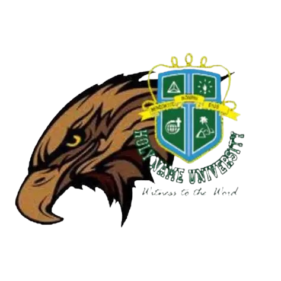
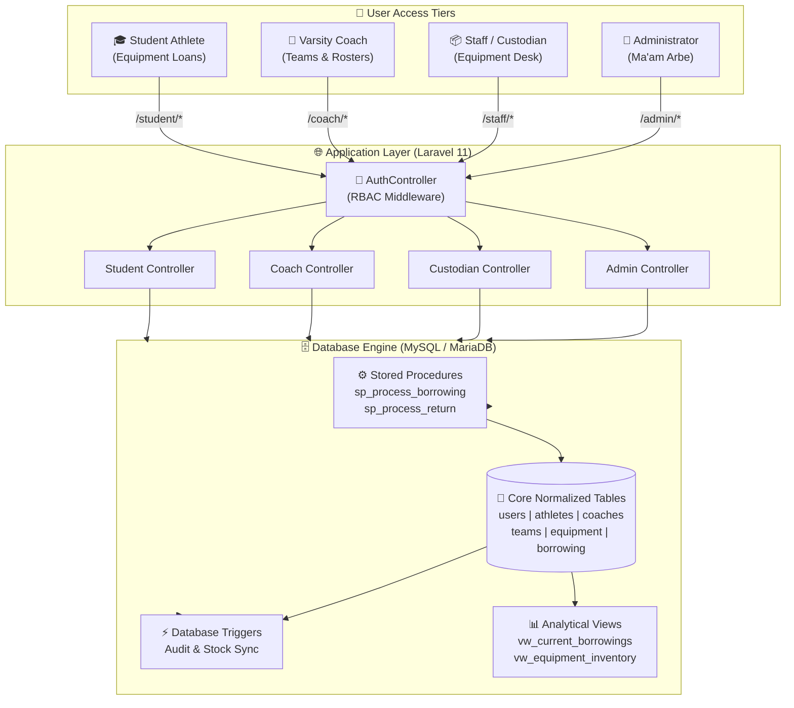

<div align="center">

  

  # 🦅 FalconSystem
  ### **Athletic Equipment & Resource Management System**
  *Advanced Database Systems & Enterprise Resource Allocation Portal*

  <p align="center">
    
    
    
    
    
  </p>

  <p align="center">
    <a href="#-interactive-portal-previews">View Portals</a> •
    <a href="#-system-architecture--how-it-works">How It Works</a> •
    <a href="#-database-engineering-features">Database Features</a> •
    <a href="#-quick-start-guide">Quick Start</a> •
    <a href="#-development-team">The Team</a>
  </p>

</div>

---

> [!NOTE]
> **Academic Project Notice**: Built for Advanced Database Management Systems (**IM101a**). Engineered with normalized relational tables, automated stored procedures, triggers, audit logging, and analytical views.

---

## 📌 Executive Summary

<table>
<tr>
<td width="60%">

**FalconSystem** is a centralized athletic inventory, team roster, and equipment management platform custom-built for **Falcons Athletics**.

It eliminates manual equipment logging, prevents inventory loss, streamlines equipment requisitions across varsity teams, and guarantees database integrity through ACID-compliant transactional logic.

</td>
<td>

### 🚀 Highlights at a Glance
- 🛡️ **Role-Based Access Control (RBAC)** (4 Distinct Tiers)
- ⚡ **Atomic Stored Procedures** (`sp_process_borrowing`, `sp_process_return`)
- 📝 **Trigger-Driven Audit Trails** (`audit_logs`)
- 📈 **Pre-computed SQL Views** (Overdue loans & stock levels)
- 🧪 **Automated Defense Test Suite** (16/16 Checks Passing)

</td>
</tr>
</table>

---

## 🔄 System Architecture & How It Works



---

## 👥 Role Clearance Breakdown

<details open>
<summary><b>1. 👑 Administrator Portal (Full System Oversight)</b></summary>
<br>

* **Target User**: Athletics Director (Ma'am Arbe)
* **Access Route**: `/admin/dashboard`
* **Core Permissions**:
  - 👥 User account management & clearance level assignment.
  - 🏃 Athlete directory and varsity team rosters.
  - 📋 Equipment master catalog creation & depreciation records.
  - 🛡️ Full trigger audit trail inspection with change logs.
  - 📊 Statistical summary dashboards and equipment status reports.

</details>

<details open>
<summary><b>2. 📦 Staff & Custodian Portal (Equipment Desk)</b></summary>
<br>

* **Target User**: Equipment Room Custodians
* **Access Route**: `/staff/dashboard`
* **Core Permissions**:
  - 📤 Immediate checkout and loan dispatch.
  - 📥 Equipment return processing with condition verification.
  - 🔧 Flagging damaged gear for maintenance & repair tracking.
  - 🚨 Low-stock alerts and equipment availability audits.

</details>

<details>
<summary><b>3. 🏅 Coach Portal (Team & Varsity Roster Desk)</b></summary>
<br>

* **Target User**: Head & Assistant Coaches
* **Access Route**: `/coach/dashboard`
* **Core Permissions**:
  - ⚾ Varsity team member roster and line-up coordination.
  - 📦 Bulk practice and game-day equipment requisition.
  - 📜 Real-time monitoring of team borrowed assets.

</details>

<details>
<summary><b>4. 🎓 Student Athlete Portal (Personal Self-Service)</b></summary>
<br>

* **Target User**: Enrolled Student Athletes
* **Access Route**: `/student/dashboard`
* **Core Permissions**:
  - 📱 View active equipment loans with expected return dates.
  - 📜 Complete transaction history and returned item receipts.
  - 🏆 Varsity team membership and coach details.

</details>

---

## 📸 Interactive Portal Previews

> Click any tab below to expand and view the high-resolution interface preview:

<details open>
<summary><b>🔑 View 1: Secure Authentication Portal (<code>/login</code>)</b></summary>
<p align="center">
  
</p>
</details>

<details open>
<summary><b>👑 View 2: Administrator Command Dashboard (<code>/admin/dashboard</code>)</b></summary>
<p align="center">
  
</p>
</details>

<details>
<summary><b>📦 View 3: Equipment Custodian Operations Desk (<code>/staff/dashboard</code>)</b></summary>
<p align="center">
  
</p>
</details>

<details>
<summary><b>🏅 View 4: Varsity Coach Roster & Gear Hub (<code>/coach/dashboard</code>)</b></summary>
<p align="center">
  
</p>
</details>

<details>
<summary><b>🎓 View 5: Student Athlete Self-Service Portal (<code>/student/dashboard</code>)</b></summary>
<p align="center">
  
</p>
</details>

---

## ⚡ Database Engineering Features

<div align="center">

| Feature Type | Routine / Object Name | Description |
| :--- | :--- | :--- |
| **Stored Procedure** | `sp_process_borrowing` | Atomically verifies stock, checks out gear, decrements available inventory, and rolls back on insufficient items. |
| **Stored Procedure** | `sp_process_return` | Restores available quantity, computes overdue days, and marks damaged units for maintenance. |
| **Stored Function** | `fn_overdue_days` | Calculates exact days elapsed beyond expected return deadlines. |
| **Stored Function** | `fn_equipment_availability` | Computes dynamic stock status (`Available`, `Low Stock`, `Out of Stock`). |
| **Trigger** | `trg_audit_equipment_insert` | Logs creation of new athletic gear into `audit_logs`. |
| **Trigger** | `trg_audit_borrowing_status` | Detects and audits loan status transitions in real time. |
| **SQL View** | `vw_current_borrowings` | Live relational snapshot of all unreturned equipment and borrower details. |
| **SQL View** | `vw_equipment_inventory` | Aggregated catalog tracking total, assigned, and damaged stock levels. |

</div>

---

## 📁 Repository Directory & File Map

```text
📂 IM101a_System/
├── 📂 app/
│   ├── 📂 Http/
│   │   ├── 📂 Controllers/
│   │   │   ├── 📄 AdminController.php         # User management, rosters, and audit trails
│   │   │   ├── 📄 AuthController.php          # Authentication, sessions, & role redirects
│   │   │   ├── 📄 BorrowingController.php     # Requisition, checkout, & return dispatch
│   │   │   ├── 📄 DashboardController.php     # Multi-role dashboard statistical loaders
│   │   │   ├── 📄 EquipmentController.php     # Equipment catalog & stock CRUD
│   │   │   └── 📄 MaintenanceController.php   # Equipment repairs & damage logs
│   │   └── 📂 Middleware/
│   │       └── 📄 CheckRole.php               # Multi-tier RBAC route authorization guard
│   └── 📂 Models/
│       ├── 📄 Athlete.php                     # Student athlete profile entity
│       ├── 📄 AuditLog.php                    # DB trigger-generated audit trail model
│       ├── 📄 BorrowingItem.php               # Transaction line-item model
│       ├── 📄 BorrowingTransaction.php        # Borrowing loan header model
│       ├── 📄 Coach.php                       # Varsity coach profile entity
│       ├── 📄 Equipment.php                   # Athletic gear entity
│       ├── 📄 MaintenanceRecord.php           # Repair tracking & condition logs
│       ├── 📄 Role.php                        # RBAC role permissions entity
│       ├── 📄 Team.php                        # Varsity & club team entity
│       └── 📄 User.php                        # Central credential & identity model
├── 📂 database/
│   ├── 📂 migrations/                         # 3NF schema tables & foreign keys
│   ├── 📂 seeders/                            # Default accounts, roles, & demo inventory
│   └── 📂 sql/
│       └── 📄 database_automation.sql         # Stored procedures, triggers, views & functions
├── 📂 public/
│   ├── 📂 images/                             # University logos & system branding
│   └── 📄 index.php                           # Application HTTP entrypoint
├── 📂 resources/views/
│   ├── 📂 admin/                              # Administrator portal Blade views
│   ├── 📂 coach/                              # Coach portal Blade views
│   ├── 📂 staff/                              # Equipment custodian Blade views
│   ├── 📂 student/                            # Student athlete Blade views
│   ├── 📂 layouts/                            # Responsive sidebar layout with RBAC navbar
│   └── 📂 auth/                               # Login & recovery interfaces
├── 📂 routes/
│   ├── 📄 web.php                             # Web routes with RBAC middleware protection
│   └── 📄 console.php                         # Artisan commands (including test:defense)
├── 📄 .env.example                            # Config template (pre-configured for port 3308)
├── 📄 serve.bat                               # Quick-start server script
└── 📄 test.bat                                # Automated defense suite runner
```

---

## 🚀 Quick Start Guide

### 1. Requirements
* **PHP** >= 8.2 (with PDO MySQL enabled)
* **XAMPP / MariaDB** (Default configured port: `3308`)
* **Composer**

### 2. Installation Steps

```bash
# 1. Clone the repository
git clone https://github.com/SamNahutdo/IM101a_System.git
cd IM101a_System

# 2. Copy the environment configuration
copy .env.example .env

# 3. Install backend dependencies
composer install

# 4. Generate system application key
php artisan key:generate

# 5. Run Database Migrations, Seeders & SQL Automation
php artisan migrate:fresh --seed
php artisan db:automation

# 6. Verify with the Automated Defense Suite
php artisan test:defense
# (or double-click test.bat)

# 7. Start the local server
php artisan serve
# (or double-click serve.bat)
```

> [!TIP]
> **Server Access**: Once running, open your browser and navigate to:
> **`http://127.0.0.1:8000`**

---

## 🔐 Default Test Accounts

| Portal Clearance | Username | Password | Notes |
| :--- | :--- | :--- | :--- |
| **👑 Administrator** | `admin` | `password123` | Full administrative control |
| **📦 Equipment Custodian** | `staff1` | `password123` | Equipment checkout & return desk |
| **🏅 Varsity Coach** | `coach_baseball` | `password123` | Baseball varsity team coach |
| **🎓 Student Athlete** | `athlete_juan` | `password123` | Enrolled student athlete |

---

## 👨‍💻 Development Team

<div align="center">

| Member | Assigned Specialty | Core Contributions |
| :---: | :---: | :--- |
| **Sam Udtohan** | **Backend Server** | System architecture, HTTP routing, RBAC middleware, controller implementation, and session security. |
| **Rizamae Velasco** | **Database Management** | Database schema design, 3NF normalization, stored procedures, triggers, audit logging, and analytical views. |
| **Ace Arcamo** | **Frontend** | UI/UX engineering, modern dashboard styling, Blade components, interactive tables, and responsive mobile layouts. |

</div>

<br>

<div align="center">
  <sub>FalconSystem • Advanced Database Systems (IM101a) • Academic Project</sub>
</div>
